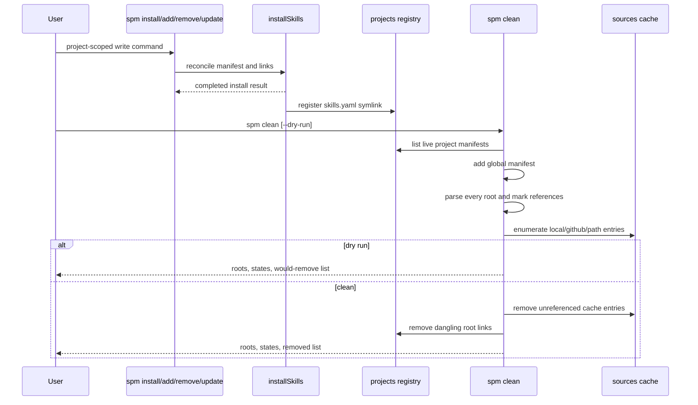

# 需求背景和约束

[[PruneUnusedSources]]

# 方案选择和澄清

## 根集合采用项目清单登记处

采用 pnpm、mise 与 Nix 的共同模式：项目级写操作成功完成安装协调后，把该项目的 `skills.yaml` 登记为机器级根。登记处位于 `<SPM_HOME>/projects/`，条目使用清单规范路径的 sha256 前 16 位命名，并以符号链接指向清单文件。

不扫描整台机器，也不维护引用计数。全局清单始终作为根；项目目录或清单被删除后，悬挂的登记链接不再构成根，并由清理过程移除。只读命令与 `--frozen` 不登记项目。

## 命令使用 clean

用户确认外部命令为 `spm clean`。它删除无人引用的缓存条目；`--dry-run` 只预览，`--json` 输出机器可读结果与本次根清单列表，`--dry-run-code` 在存在待清理项时返回非零退出码。命令不提供清空全部缓存的模式。

## 声明只报告

全局 `repositories:` 与 `aliases:` 属于用户声明。无人引用时只报告，并给出已有的 `spm repository remove` 或 `spm alias remove` 命令。清理过程只删除可重建的缓存和失效的项目根登记，不改写任何清单。

## 清理范围与时间语义

`local`、`github`、`path` 三类缓存统一参与标记与清扫。不设置宽限期，也不使用 atime 或 mtime 推断使用情况；所有删除对象均可由后续 `spm i` 重建。默认退出码保持成功，CI 通过 `--dry-run-code` 选择严格判定。

# 整体实现思路

## 相关文件

```text
src/
├── config.ts                         # 定义并展示 <SPM_HOME>/projects 根登记目录
├── cli/
│   ├── index.ts                      # 注册顶层 clean 命令
│   └── commands/
│       ├── clean.ts                  # 参数、文本/JSON 输出、退出码
│       └── config.ts                 # 输出项目根登记目录
└── core/
    ├── clean.ts                      # 收集根、标记引用、分类缓存、执行清扫
    ├── install.ts                    # 项目级安装写操作成功后登记清单根
    ├── project-registry.ts           # 根链接的创建、枚举、去重与悬挂清理
    └── source.ts                     # 枚举和删除 local/github/path 缓存条目

test/
├── clean.test.ts                     # 根集合、可达性、分类与清扫单元测试
├── cli.test.ts                       # clean 命令、项目登记和输出契约测试
└── helpers.ts                        # 隔离项目根目录与缓存的测试助手

README.md                             # 命令表、缓存布局、使用示例与安全边界
docs/PROMPT.md                        # 根登记、clean 语义、验收与测试要求
```

## 时序图



## 流程图

```text
收集根
  ├─ 全局 skills.yaml（存在时）
  └─ projects/<hash> 指向的仍存在项目清单
       └─ 悬挂根：记录为待清理登记
            ↓
读取并校验全部根清单
  ├─ 任一清单无效：立即失败，零删除
  └─ 全部有效：继续
            ↓
标记
  ├─ skills: local:name:*       → local/name
  ├─ skills: github:o/r:*       → github/o/r
  ├─ skills: path:<dir>         → path/<hash>
  ├─ skills: alias:name         → 标记 alias，并展开目标坐标
  └─ repositories: <name>       → 保留对应 local/name 登记
            ↓
分类
  ├─ live：有清单引用或声明
  ├─ unused：无引用、无声明，可删除
  ├─ broken-live：目标失效但仍有声明或引用，只报告
  └─ foreign：缓存位置被非预期真实文件占用，只报告
            ↓
清扫
  ├─ --dry-run：零写入
  └─ 默认：删除 unused + 悬挂项目根
            ↓
报告未使用声明
  ├─ repository → spm repository remove <name>
  └─ alias      → spm alias remove <name>
```

# 外部资源参考

## 实现模式

### pnpm 项目登记与标记清扫

采用 pnpm 全局 virtual store 的项目登记思想：store 维护使用者清单，再从全部使用者标记可达内容。参考 [[PruneUnusedSources/Researchs/PackageManagerStorePruning]]。

### mise 配置文件追踪

项目清单承担 mise tracked-configs 的角色；`--dry-run` 与 `--dry-run-code` 采用 mise 的命令契约。

### Nix GC roots

项目登记使用符号链接，目标消失后悬挂链接不构成根。根列表需要进入 JSON 输出，保证清理判定可核对。

## Ability

- skill(specool-specify)
- skill(specool-research)
- skill(specool-plan)

# 具体实施细节

## 核心代码

### 项目根登记

`project-registry.ts` 负责根登记目录，不把项目列表写进全局清单：

- 清单路径先规范化，再生成稳定哈希键；同一路径重复安装保持幂等。
- 符号链接目标是具体的 `skills.yaml`，项目移动或删除会自然形成悬挂根。
- 枚举时拒绝把登记目录中的普通文件或目录当成根，也不删除这些外来条目。
- 项目级安装写操作完整执行后登记根；全局作用域、只读命令与 `--frozen` 不登记。
- 登记接入共享的 `installSkills` 成功路径，使 `install`、`add`、`remove`、`update` 与 `doctor --fix` 使用同一条规则。

### 根清单读取与快速失败

`clean.ts` 先收集所有根，再读取任何缓存状态。全局清单不存在时只使用项目根。根按规范路径去重并稳定排序。

任何仍存在的根清单出现 YAML、schema、坐标、alias 或 repository 层级错误时，`spm clean` 在删除前立即失败。悬挂项目根不参与解析，默认清理时只删除该登记链接；`--dry-run` 仅报告。

### 可达性标记

使用现有 `manifestCoordinates`、坐标类型、`globalAliases`、`repositoryLayers` 与路径解析规则计算引用，不触发发现、clone 或注册：

- `local:` 标记名称对应的 local 缓存；项目层声明优先于全局层。
- `github:` 标记 `owner/repo` 对应的 github 缓存。
- `path:` 按该清单目录解析相对路径，并复用 `pathSourceEntry` 生成稳定缓存键。
- `alias:` 标记 alias 自身为已使用，再按 alias 的 `$HOME` 基准展开目标坐标；现有 schema 已禁止 alias 链与整仓库 alias。
- 每份根清单的 `repositories:` 声明也保留对应 local 缓存，避免清理后制造 `declaredNotRegistered` 状态。
- 记录每个缓存条目的引用根列表，供文本与 JSON 输出解释判定。

### 缓存分类与删除安全

扩展 source 层以完整枚举三类缓存，包括悬挂符号链接：

- `local`、`path` 只删除由 spm 管理的符号链接；缓存位置出现普通文件或目录时报告 foreign 并保留。
- `github` 只在无人引用时删除仓库目录；仍被引用但缺少 `.git` 时报告 broken-live 并保留，让 `spm i` 或用户处理。
- 目标已消失且无人引用的 local/path 悬挂链接归入 unused，可删除；仍有声明或引用时归入 broken-live，只报告。
- 所有删除路径必须先确认位于各自缓存根目录内，避免目录遍历和越界删除。
- 先完成完整分类，再集中执行删除，防止解析到中途时留下半次清理结果。

### 命令输出与退出码

文本输出按 `live`、`unused/removed`、`broken`、`unused declarations` 分组，条目按 kind 与 id 稳定排序。无待清理项时输出明确的 clean 状态。

JSON 输出保持 stdout 可直接解析，至少包含：`roots`、`entries`、`danglingRoots`、`unusedRepositories`、`unusedAliases`、`removed`、`dryRun`。诊断与失败信息写 stderr。

默认与 `--dry-run` 在成功完成分析后返回 0；`--dry-run-code` 仅在分析成功且存在待清理缓存或悬挂项目根时返回 1。解析错误、越界或删除失败统一返回 1。

## 其他相关改动

- `spm config` 的文本与 JSON 输出增加 `projectsDir`。
- README 增加 `spm clean` 命令、三个旗标、根登记目录、声明只报告的安全边界和代表性输出。
- `docs/PROMPT.md` 增加项目根登记、机器级 clean 与缓存可达性判据；保留「无数据库、无引用计数、无反向扫描」原则并解释符号链接登记不违反这些原则。
- 测试覆盖：登记幂等、只读/冻结不登记、删除项目后的悬挂根、多项目共享缓存、global/project repository 层级、alias 展开、path 相对路径、三类缓存清扫、本地目标保留、声明只报告、foreign 条目保护、根清单失败时零删除、dry-run、JSON、dry-run-code、clean 幂等。
- 完成后运行 `npm test`、`npm run typecheck`、`npm run build`，并用隔离 `SPM_HOME` 执行一次完整 CLI 场景验证。
